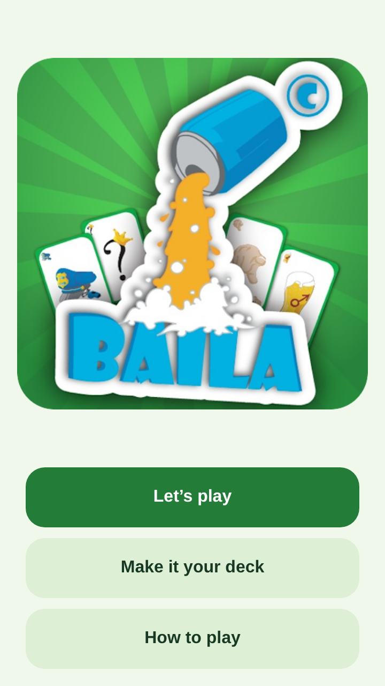
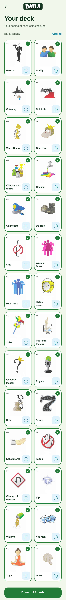
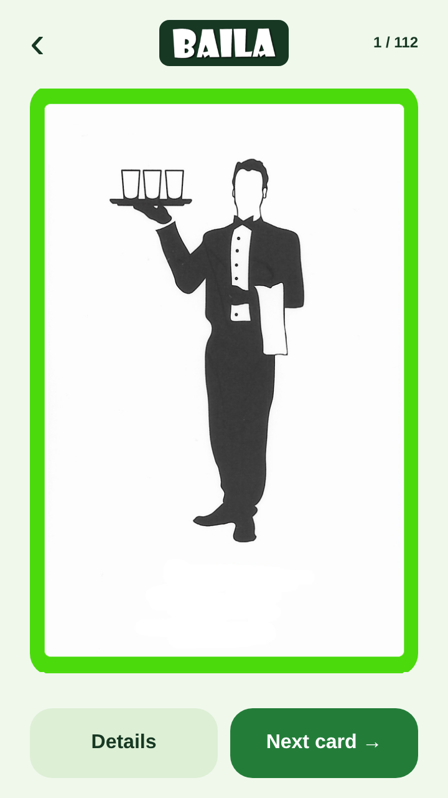
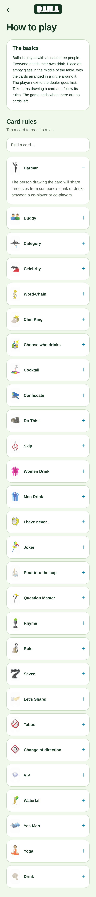

# BAILA

### A playful mobile card game, built with React Native


Choose your cards, shuffle the deck, and play together. BAILA brings 28 illustrated card types to a simple mobile interface with swipe navigation and rules available whenever you need them.

[**Download Android preview**](https://github.com/giarous/baila-v2/releases) · [Build an APK](https://github.com/giarous/baila-v2/actions/workflows/android-apk.yml) · [Architecture](docs/ARCHITECTURE.md) · [Development guide](docs/DEVELOPMENT.md)

## A look inside

The **Classic BAILA** palette takes its green and cyan accents from the game logo, with a pale green background and clean white cards.

These images capture the **actual app components rendered in a browser for documentation**. They are not Android device screenshots; native fonts, dialogs, safe areas, and system chrome may differ. The capture script uses the production screens rather than a separate mockup. Home and gameplay use 9:16 framing; deck selection and instructions show their full scrollable content so cards and rules are not cut off.

<table>
<tr><th>Home</th><th>Your deck</th><th>Gameplay</th><th>How to play</th></tr>
<tr>
<td></td>
<td></td>
<td></td>
<td></td>
</tr>
</table>

## What you can do

- Build a custom deck from 28 card types, with four copies of every selected type.
- Check any card's rules from its independent Info button without changing your selection.
- Swipe through a shuffled deck or use Next card. Gameplay keeps the artwork visible and opens rules through Details.
- Search English card names, expand instructions, and read rules through clear information controls.

Home and gameplay use fixed layouts. Deck selection uses compact 3:4 tiles. Deck selection survives navigation during a session and resets when the app restarts. No account or backend is required.

## Engineering decisions

| Concern      | Approach                                                                                            |
| ------------ | --------------------------------------------------------------------------------------------------- |
| Presentation | Dedicated screen components, reusable UI controls, and semantic design tokens                       |
| State        | A session provider above a small four-screen router                                                 |
| Game logic   | Pure deck construction and immutable Fisher–Yates shuffling, with injectable randomness for testing |
| Content      | Shared English interface copy and a single-language card catalogue                                  |
| Interaction  | React Native animation and gesture primitives; independent selection and information targets        |
| Verification | Jest screen/integration tests, ESLint, formatting checks, and a reproducible UI capture script      |
| Delivery     | Manual GitHub Actions APK builds with signature and application metadata checks                     |

See [Architecture](docs/ARCHITECTURE.md) for module boundaries and testing coverage.

## Run locally

Use Node **22.13+ within Node 22**, or **24.3+**, JDK 17, and Android SDK 36. See the [development guide](docs/DEVELOPMENT.md) for signing setup and complete prerequisites.

```sh
npm ci
npm start
# In another terminal, with a device or emulator connected:
npm run android
```

```sh
npm test -- --runInBand --watch=false
npm run lint
npm run format:check
```

The installed name is **BAILA**. Its application ID is `com.tbaila.v2`, allowing it to coexist with the original app. APKs are attached to [GitHub Releases](https://github.com/giarous/baila-v2/releases), not committed into the source tree. A new APK is produced only after running the manual build workflow. These are development-signed previews, not Google Play releases. iOS sources are included but require validation on macOS.

## Project ownership

A personal project by [giarous](https://github.com/giarous).

## Credits and rights

This app was created as a personal challenge and is not affiliated with or endorsed by “Baila”. All associated copyrights and trademarks belong to their respective owners. The physical version can be found on [Baila Games](https://www.facebook.com/BailaGames). No additional license to third-party artwork or branding is implied by this repository.
