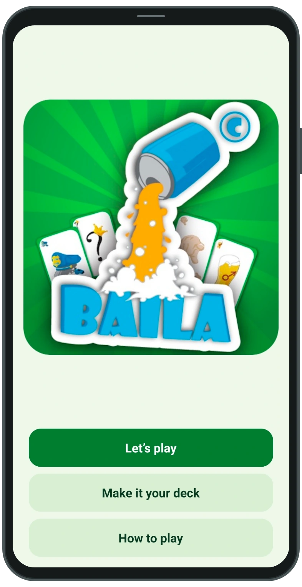
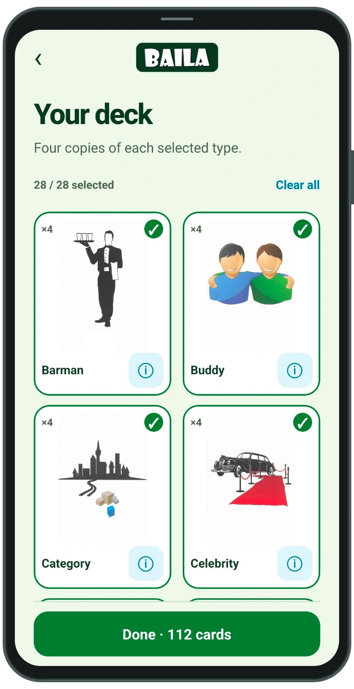
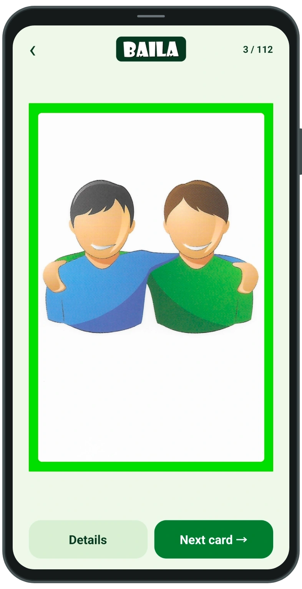
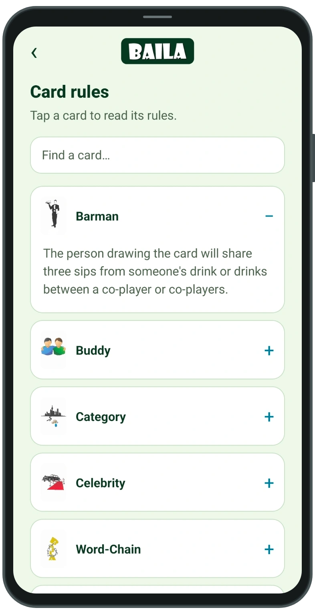

# BAILA


[](https://github.com/giarous/baila-v2/actions/workflows/quality.yml)

BAILA is a React Native party card game for groups sharing one phone. Choose from 28 illustrated card types, swipe through your shuffled deck, and look up rules as you play. The app works offline and requires no account.

[**Download Android preview**](https://github.com/giarous/baila-v2/releases) · [Build an APK](https://github.com/giarous/baila-v2/actions/workflows/android-apk.yml) · [Architecture](docs/ARCHITECTURE.md) · [Development guide](docs/DEVELOPMENT.md)

## A look inside

<table>
<tr><th>Home</th><th>Your deck</th><th>Gameplay</th><th>How to play</th></tr>
<tr>
<td></td>
<td></td>
<td></td>
<td></td>
</tr>
</table>

## How it works

- **Build a deck.** Each selected card type adds four copies. Open a card’s Info button to read its rule without changing the selection.
- **Play at your pace.** Swipe or tap Next card to advance. The card stays artwork-first, with its rule available through Details.
- **Find a rule.** Search by card name and expand a rule without starting a game.

## Engineering highlights

- **Session state.** A React Context provider above the navigator keeps the deck selection in memory as players move between screens. [GameContext.js](src/state/GameContext.js)
- **Testable shuffle.** Deck construction creates a fresh array, then applies Fisher–Yates with injectable randomness for deterministic tests. [deck.js](src/game/deck.js)
- **Gesture handling.** The swipe stack advances the deck when a gesture commits and reads the latest callbacks during animations. [CardStack.js](src/components/CardStack.js)
- **Verification and delivery.** CI runs Jest, ESLint, and Prettier. The separate APK workflow checks the package signature, application ID, display name, and Android target. [GitHub Actions](https://github.com/giarous/baila-v2/actions)

## Run locally

Use Node **22.13+ within Node 22**, or **24.3+**, JDK 17, and Android SDK 36. See the [development guide](docs/DEVELOPMENT.md) for signing setup and complete prerequisites.

```sh
npm ci
npm start
# In another terminal, with a device or emulator connected:
npm run android
```

```sh
npm test -- --runInBand --watch=false
npm run lint
npm run format:check
```

The APK is a development-signed preview. See the [Android preview notes](docs/android-preview-notes.md) for installation and signing details. The iOS project requires validation on macOS.

## Project ownership

A personal project by [giarous](https://github.com/giarous).

## Credits and rights

This app was created as a personal challenge and is not affiliated with or endorsed by “Baila”. All associated copyrights and trademarks belong to their respective owners. The physical version can be found on [Baila Games](https://www.facebook.com/BailaGames). No additional license to third-party artwork or branding is implied by this repository.
